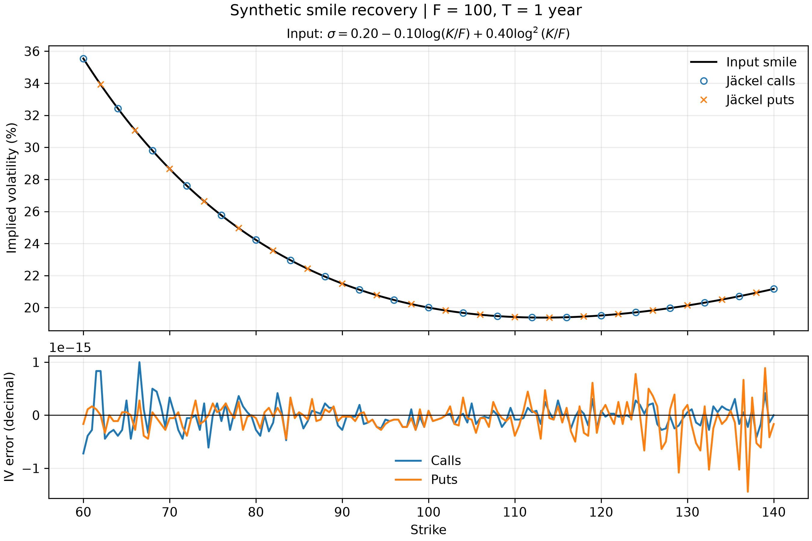

# Jäckel implied volatility

A small, reusable C++ implementation of Peter Jäckel's Black implied volatility solver, with scalar and batch entry points. No external dependencies.

- **Compiler:** Apple Clang 17.0.0 (`g++`), `-O3 -Werror -std=c++17`.
- **CPU:** Apple M4, 10 cores (4 performance + 6 efficiency).
- **Throughput (single thread):** 6.23 million options/s; 160.6 ± 1.9 ns/option (batch mean ± SD). 6,553,600 options in 1.052 s.

Supporting code and documentation: [MIT](LICENSE), © 2026 Saad Souilmi. `src/jackel.h` and `src/jackel.cpp` retain [Jäckel's original license](THIRD_PARTY_LICENSES), © 2013–2014 Peter Jäckel.
